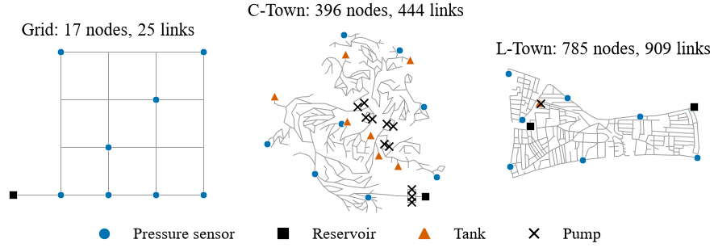

# WaterBench · Experts Under Pressure

**A simulation-based benchmark of general-purpose LLMs and specialist models for water-network analysis.**

Companion code for **Experts Under Pressure: Benchmarking LLMs versus Engineered Water-Network Management Models**.

Marco Casalbore · Pietro Spadaccino · Jin Nakazato · Massimo Panella · Nicola B. Melazzi · Francesca Cuomo



## What does the benchmark ask?

Can a general-purpose language model solve numerical water-network tasks directly from observations? WaterBench compares independent, zero-shot responses with task-specific methods across a synthetic grid, C-Town, and L-Town.

| Task | Supplied observations | Required response |
|---|---|---|
| **Leak detection and localization** | Pressure history, nominal pressures, zones, and nominal leak signatures | Alarm, score in [0, 1], and ranked candidate zones |
| **Demand forecasting** | The previous 168 hourly intended-demand values | The next 24 hourly values in L/s |
| **Consumption-shape clustering** | Twelve normalized daily profiles and the known cluster count | A complete partition into three nonempty groups |

Reported LLM conditions use no external tools, retrieval, fine-tuning, persistent memory, or response repair. Strict output validation makes failed attempts visible alongside predictive performance.

## Start here

- [Prompts and complete example requests](prompts/README.md)
- [Setup and running experiments](docs/reproduction.md)
- [Protocol and scoring](docs/protocol.md)
- [Models and specialist baselines](docs/models.md)
- [Network sources and attribution](THIRD_PARTY_NOTICES.md)

## Install

Use **Python 3.12 or 3.13**, from the repository root:

```bash
python -m venv .venv
# Linux / macOS:
source .venv/bin/activate
# Windows PowerShell: .venv/Scripts/Activate.ps1
python -m pip install -r requirements.lock.txt
python -m pip install --no-deps --no-build-isolation -e .
python -m waterbench --help
```

The lock file records the original core scientific environment. Supplementary baselines have a separate environment; see the [setup guide](docs/reproduction.md).

## Try it without a language model

This small example generates synthetic Grid data and runs a seasonal-naive forecasting baseline. It requires no GPU, API key, or model download.

```bash
python -m waterbench prepare --config configs/smoke.json --output data/datasets/demo
python -m waterbench audit --dataset data/datasets/demo
python -m waterbench run --dataset data/datasets/demo --methods seasonal-naive --tasks forecast --networks grid --split validation
```

The last command prints a run directory. To score it, replace `RUN_DIRECTORY` with that path:

```bash
python -m waterbench evaluate --dataset data/datasets/demo --runs RUN_DIRECTORY
python -m waterbench report --evaluation EVALUATION_DIRECTORY
```

The evaluator prints `EVALUATION_DIRECTORY`. The [experiment guide](docs/reproduction.md) also covers three-task datasets, local endpoints, prompt export, supplementary baselines, and frozen tests.

## Repository map

```text
waterbench/       Dataset generation, model calls, validation, scoring, reporting
configs/          Baselines, small dataset configs, endpoint and metadata examples
data/networks/    Grid, C-Town, L-Town, checksums, and source attribution
prompts/          Exact system/task instructions and one full example per task
scripts/          Campaign runner, freeze checks, baseline adapters, verification
tests/            Software fixtures, metric checks, and hydraulic regression tests
docs/             Usage, methodology, and model descriptions
```

This repository distributes the experimental software and prompt contract. Campaigns, measured results, response archives, generated datasets, model weights, credentials, and private execution environments are not included. New runs produce local datasets and outputs.

## Reading the paper

The paper compares nine LLM configurations with thirteen specialist baselines. Strong generalists match the simple clustering baseline on this controlled task, while direct Lasso and the fixed forecasting ensemble remain more accurate. Leak detection and localization show different trade-offs between recall, false alarms, localization, and output validity.

These experiments use simulated networks and synthetic demand profiles; they do not establish readiness for operational deployment. Cloud products expose different controls from local APIs, and unknown provider settings should remain explicitly unknown.

## Citation and reuse

The proceedings will be published in the next weeks. If interested in a pre-print version of the article, please contact the authors.

See [CITATION.cff](CITATION.cff) for the title and authors. Publication metadata can be completed when the venue and DOI are available.

Third-party network terms are documented in [THIRD_PARTY_NOTICES.md](THIRD_PARTY_NOTICES.md). A repository-wide software license has not yet been assigned by the authors.
